<p align="center">
  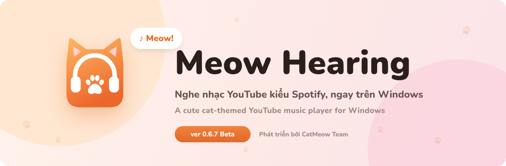
</p>

<p align="center">
  <a href="https://github.com/CatMeowTeam/MeowHearing/releases/latest"></a>
  
  
</p>

<p align="center">
  <b>Tiếng Việt</b> · <a href="#-english">English</a>
</p>

---

## 🐱 Meow Hearing là gì?

Muốn nghe nhạc YouTube mà trình duyệt cứ ngốn RAM, tab lẫn lộn, tắt màn hình là tắt nhạc?
**Meow Hearing** biến YouTube thành một app nghe nhạc xinh xắn kiểu Spotify: tìm bài, tạo playlist, xem lời chạy theo nhạc, thu nhỏ thành mini player, ẩn xuống khay hệ thống mà nhạc vẫn phát.

Không cần API key, không cần tài khoản. Muốn mang playlist và bài đã thích từ YouTube sang thì bấm **Đăng nhập YouTube** một cái là xong.

<p align="center">
  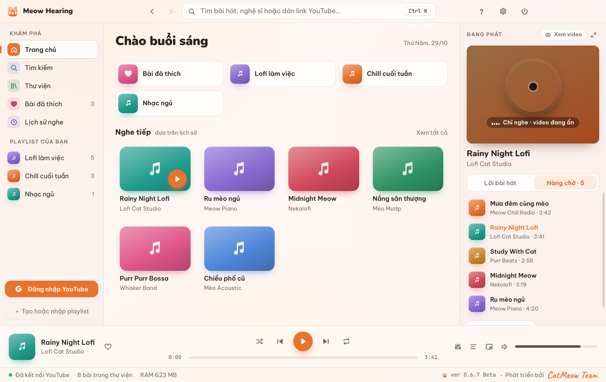
</p>

## ✨ Tính năng

| | |
|---|---|
| 🔎 **Tìm là nghe** | Gõ tên bài, ca sĩ hoặc dán link YouTube. Không cần API key |
| 📂 **Playlist của bạn** | Tạo, đổi tên, kéo thả sắp xếp, trộn bài. Nhập cả playlist YouTube chỉ bằng một link |
| 🔑 **Đăng nhập YouTube** | Mở Chrome/Edge/Cốc Cốc để đăng nhập an toàn, xong quay về app: thấy playlist và video đã thích. Có Premium thì không quảng cáo |
| 🎤 **Lời bài hát chạy theo nhạc** | Ưu tiên phụ đề của YouTube, không có thì lấy từ LRCLIB. Tự bỏ qua đoạn nhạc dạo của MV, chỉnh lệch ±0.5s được |
| 🎧 **Chỉ nghe, không cần xem** | Video ẩn mặc định và tự hạ chất lượng hình để nhẹ máy. Cần xem thì bấm **Xem video** |
| 🎚️ **Âm thanh hay hơn** | Tắt chế độ YouTube tự giảm âm lượng (giữ tiếng gốc), bộ chỉnh âm 10 dải với sẵn kiểu Bass mạnh, Giọng hát, Bolero, Loa laptop… |
| 🚫 **Bỏ qua quảng cáo** | Bật/tắt trong Cài đặt. Quảng cáo bị tắt tiếng và tua qua ngay, nhạc phát tiếp liền mạch |
| 🪟 **Mini player** | Cửa sổ nhỏ luôn nổi trên cùng, vừa làm việc vừa đổi bài |
| ⌨️ **Phím media & phím tắt** | Phím Play/Next trên bàn phím chạy được cả khi app đang ẩn |
| ⏻ **Hẹn giờ tắt nhạc** | 15, 30, 45, 60, 90 phút. Nghe nhạc ngủ không lo cả đêm |
| 💾 **Dữ liệu ở máy bạn** | Playlist, bài đã thích, lịch sử lưu bằng SQLite trên máy. Xuất/nhập file JSON để chuyển máy |
| 🌏 **Tiếng Việt & English** | Chọn lúc mở lần đầu, đổi lại bất cứ lúc nào |

<p align="center">
  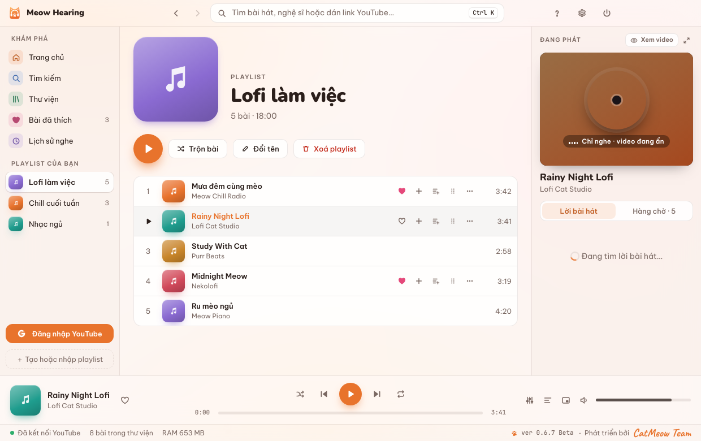
</p>

## 🎨 Năm bộ màu mèo

Giống hệt bên [Meow Launcher](https://github.com/CatMeowTeam/MeowLauncher): Mướp, Trắng, Hồng, Xám, Mun (chế độ tối), hoặc **Theo Windows** tự đổi sáng tối.

<p align="center">
  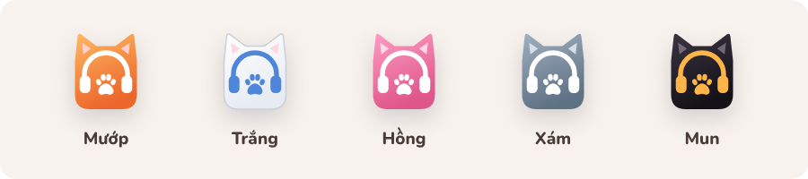
</p>

<table>
  <tr>
    <td width="50%">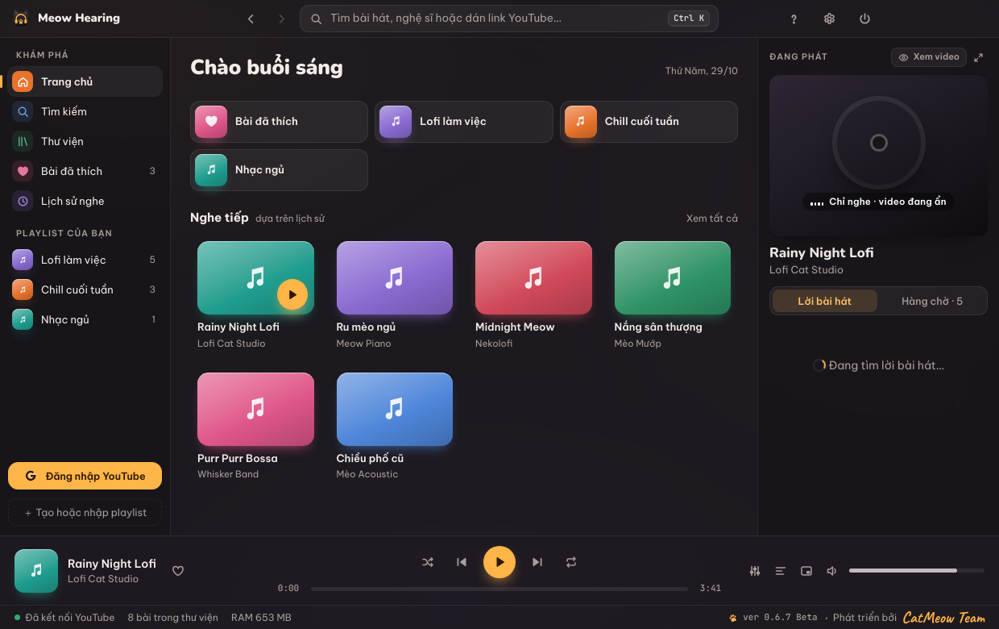<p align="center"><sub>Chế độ Mun (tối)</sub></p></td>
    <td width="50%">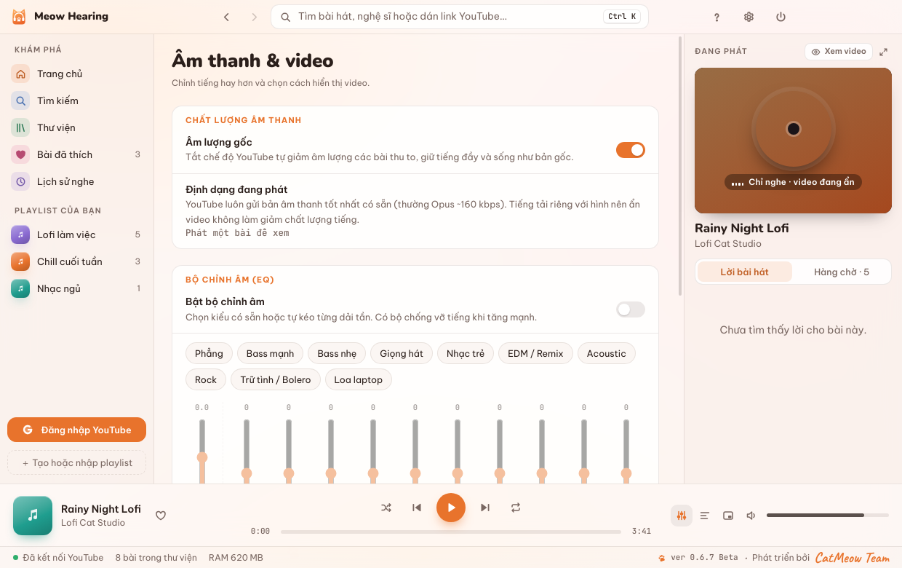<p align="center"><sub>Âm lượng gốc và bộ chỉnh âm 10 dải</sub></p></td>
  </tr>
  <tr>
    <td>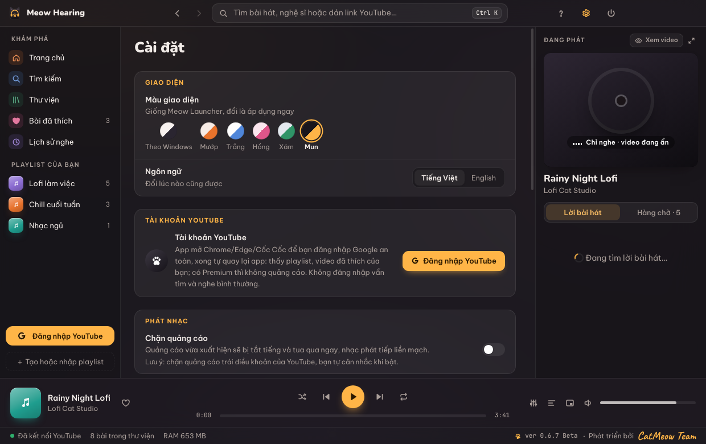<p align="center"><sub>Cài đặt: màu, ngôn ngữ, tài khoản, chặn quảng cáo</sub></p></td>
    <td>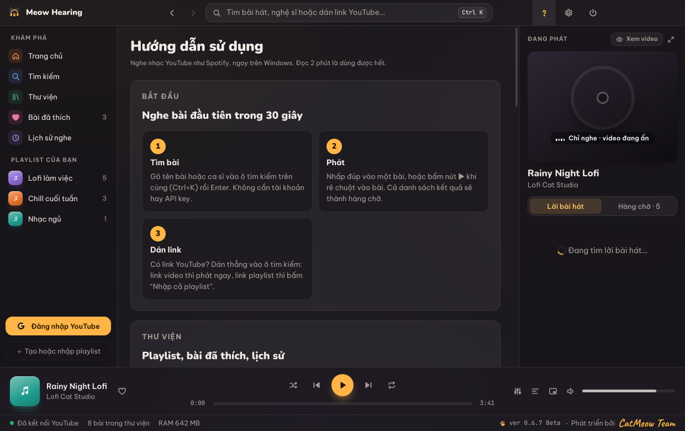<p align="center"><sub>Hướng dẫn sử dụng ngay trong app</sub></p></td>
  </tr>
</table>

<p align="center">
  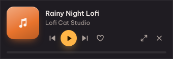<br>
  <sub>Mini player luôn nổi trên cùng</sub>
</p>

## 📥 Cài đặt

1. Vào [**Releases**](https://github.com/CatMeowTeam/MeowHearing/releases/latest), tải `MeowHearing-Setup-0.6.7.exe`.
2. Mở file cài. Nếu Windows hiện màn hình xanh *“Windows đã bảo vệ máy tính của bạn”*, bấm **Thông tin thêm → Vẫn chạy**.
   <sub>(Meow chưa có chữ ký số nên Windows cảnh báo vậy thôi, mèo ngoan lắm 🐾)</sub>
3. Máy có ổ D thì mặc định cài vào `D:\Meow Hearing`, đổi được ở bước chọn thư mục. Không cần quyền Admin.
4. Mở app lần đầu: chọn ngôn ngữ, gõ tên bài vào ô tìm kiếm, bấm phát. Xong!

<sub>Không muốn cài? Tải bản `MeowHearing-Portable-0.6.7.exe`, chạy luôn.</sub>

## ⌨️ Phím tắt

| Phím | Việc |
|---|---|
| <kbd>Ctrl</kbd> + <kbd>Alt</kbd> + <kbd>Space</kbd> | Mở hoặc ẩn Meow Hearing (đổi được trong Cài đặt) |
| <kbd>Space</kbd> | Phát / tạm dừng |
| <kbd>Ctrl</kbd> + <kbd>→</kbd> / <kbd>Ctrl</kbd> + <kbd>←</kbd> | Bài tiếp / bài trước |
| <kbd>→</kbd> / <kbd>←</kbd> | Tua tới / lùi 5 giây |
| <kbd>↑</kbd> / <kbd>↓</kbd> | Tăng / giảm âm lượng |
| <kbd>L</kbd> | Thích bài đang phát |
| <kbd>Ctrl</kbd> + <kbd>K</kbd> | Nhảy vào ô tìm kiếm |
| <kbd>Alt</kbd> + <kbd>←</kbd> / <kbd>Alt</kbd> + <kbd>→</kbd> | Quay lại / tiến tới trang |
| Phím media ⏯ ⏭ ⏮ | Điều khiển nhạc kể cả khi app đang ẩn |

Hướng dẫn đầy đủ có ngay trong app: bấm nút **?** trên thanh tiêu đề.

## 😿 Lỡ muốn gỡ Meow…

Trình gỡ sẽ hỏi lại cho chắc và cho bạn chọn **giữ lại** hay **xoá luôn** playlist, bài đã thích, lịch sử nghe.
Mặc định dữ liệu được giữ lại, cài lại là dùng tiếp ngay.

<p align="center">
  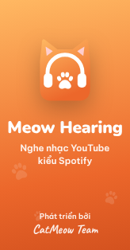
  &nbsp;&nbsp;&nbsp;
  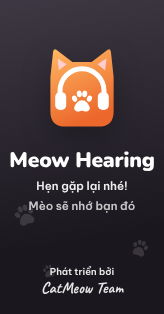<br>
  <sub>Mướp chào đón lúc cài · Mun tiễn bạn lúc gỡ</sub>
</p>

## ❓ Hỏi nhanh

<details>
<summary><b>Có cần API key hay tài khoản Google không?</b></summary>

Không. Tìm bài, nghe nhạc, tạo playlist đều chạy ngay. Đăng nhập chỉ để lấy playlist, video đã thích từ tài khoản YouTube của bạn (và hết quảng cáo nếu có Premium).
</details>

<details>
<summary><b>Bấm Đăng nhập YouTube rồi làm gì tiếp?</b></summary>

App mở trình duyệt có sẵn trên máy (Chrome, Edge, Cốc Cốc hoặc Brave). Bạn đăng nhập Google như bình thường, xong quay lại app bấm **Xong**. Meow chỉ chép phiên đăng nhập YouTube vào app, không lưu mật khẩu, và xoá hồ sơ trình duyệt tạm ngay sau đó.
</details>

<details>
<summary><b>Có nghe được nhạc lossless không?</b></summary>

YouTube chỉ gửi tối đa khoảng Opus ~160 kbps, nên không có lossless. Meow giúp tiếng hay hơn bằng cách tắt chế độ YouTube tự giảm âm lượng và cho chỉnh EQ. Ẩn video không làm giảm chất lượng tiếng vì tiếng và hình tải riêng.
</details>

<details>
<summary><b>Bài này không có lời?</b></summary>

Meow tìm phụ đề trên YouTube trước, rồi tới kho lời LRCLIB. Một số bài ít người nghe hoặc bản remix có thể chưa có. Lời chạy lệch thì bấm nút **−0.5s / +0.5s**, app nhớ cho từng bài.
</details>

<details>
<summary><b>Bấm X sao nhạc không tắt?</b></summary>

X chỉ ẩn Meow xuống khay hệ thống để nhạc vẫn phát. Muốn tắt hẳn: bấm nút nguồn ⏻ trên thanh tiêu đề › **Thoát**, hoặc chuột phải icon ở khay › **Thoát**.
</details>

<details>
<summary><b>Dữ liệu lưu ở đâu? Chuyển sang máy khác thế nào?</b></summary>

Trong `%APPDATA%\Meow Hearing\meow.db`. Vào **Cài đặt › Xuất thư viện (JSON)**, sang máy mới chọn **Nhập thư viện**.
</details>

<details>
<summary><b>Chặn quảng cáo có vi phạm gì không?</b></summary>

Tính năng này tắt mặc định. Bỏ qua quảng cáo trái với điều khoản của YouTube, bạn tự cân nhắc khi bật. Cách ủng hộ người làm nhạc tốt nhất vẫn là YouTube Premium 🧡
</details>

## 🧑‍💻 Build từ mã nguồn

Cần [Node.js](https://nodejs.org) 20 trở lên.

```bash
git clone https://github.com/CatMeowTeam/MeowHearing.git
cd MeowHearing
npm install
npm start           # chạy thử
npm run dist:win    # đóng gói bộ cài + bản portable vào thư mục release/
```

<sub>Build trên Linux/macOS cần thêm `wine` để NSIS tạo trình cài. Đẩy tag `v*` lên GitHub thì GitHub Actions tự build và đính file `.exe` vào Releases.</sub>

<details>
<summary>Cấu trúc thư mục</summary>

```
electron/
  main.js          # tiến trình chính: cửa sổ, khay hệ thống, phím tắt, mini player
  ytview.js        # trình phát: trang YouTube ẩn + cầu nối điều khiển, EQ, chất lượng video
  innertube.js     # tìm kiếm, playlist, bài đã thích qua API nội bộ của YouTube (không cần key)
  api.js           # gom dữ liệu, lời bài hát (LRCLIB), bộ nhớ đệm
  browserlogin.js  # đăng nhập bằng trình duyệt thật trên máy
  adblock.js       # bỏ qua quảng cáo
  db.js            # SQLite (sql.js) cho playlist, bài đã thích, lịch sử
src/               # giao diện React: màn hình, bộ màu, bản dịch, hướng dẫn
build/             # icon, ảnh trình cài, script NSIS
scripts/           # gắn icon và thông tin phiên bản vào file exe
docs/              # ảnh cho README
```
</details>

---

## 🇬🇧 English

**Meow Hearing** is a cute, cat-themed YouTube music player for Windows 10/11, in the style of Spotify.

- Search songs or paste a YouTube link. No API key or account needed.
- Local playlists with drag-to-reorder, likes, listening history; import any YouTube playlist by link.
- One-click **Sign in with YouTube** through your own browser to bring your playlists and liked videos.
- Synced lyrics from YouTube captions or LRCLIB, with automatic intro offset and manual ±0.5s nudges.
- Audio-only mode by default (video hidden and downgraded to save resources), original loudness and a 10-band EQ.
- Optional ad skipping, mini player, media keys, sleep timer, tray mode.
- Five cat color themes shared with [Meow Launcher](https://github.com/CatMeowTeam/MeowLauncher), Vietnamese & English.

<p align="center">
  
</p>

**Install:** grab the latest `.exe` from [Releases](https://github.com/CatMeowTeam/MeowHearing/releases/latest). If SmartScreen appears, click **More info → Run anyway** (the installer isn’t code-signed yet).

<sub>Meow Hearing is not affiliated with YouTube or Google. Please respect YouTube’s Terms of Service and support artists.</sub>

---

<p align="center">
  <br>
  <sub>ver 0.6.7 Beta · Phát triển bởi <b>CatMeow Team</b> · Made with 🧡 and lots of meows</sub>
</p>
